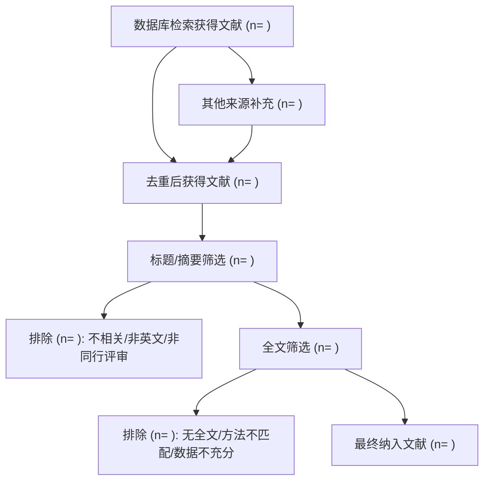

# 模块8：文献调研与综述

> 来源吸收：scicomp-research-skills（literature-survey/skill.md）+ systematic-literature-review（PRISMA）

## 触发关键词
文献调研、文献综述、literature review、survey、related work、文献搜索、文献检索、系统综述、systematic review、PRISMA、元分析、meta-analysis

## 工作流

### 阶段1：文献搜集

#### 1.1 搜索策略设计
- **数据库选择**：arXiv、Semantic Scholar、Google Scholar、DBLP、IEEE Xplore、PubMed（按领域选）
- **关键词设计**：核心词 + 同义词 + 缩写变体 + 布尔组合
- **时间范围**：近3-5年为主，经典论文回溯
- **搜索记录**：记录每次搜索的数据库、关键词、结果数、日期

#### 1.2 文献筛选（PRISMA 流程）

执行步骤：
```
全量搜索 → 去重 → 标题/摘要筛选 → 全文筛选 → 最终纳入
```
- 记录每一步排除的论文数和原因
- 制作 PRISMA 流程图（输出以下 Mermaid 代码）

**PRISMA 流程图模板**（直接输出此代码，填入实际数字）：


#### 1.3 搜索字符串模板

按领域提供可复用的搜索字符串：
```
# ML/CV 论文搜索 (Semantic Scholar / arXiv)
("attention mechanism" OR "self-attention" OR "transformer") AND (image OR vision OR classification) 
  year:2022-2026

# NLP 论文搜索
("large language model" OR "LLM") AND (evaluation OR benchmark OR reasoning) 
  year:2023-2026

# 系统综述搜索 (PubMed / Scopus)
("systematic review" OR "meta-analysis") AND (PRISMA OR "literature survey") 
  year:2020-2026
```

#### 1.4 文献获取
- PDF 下载与归档（命名规范：`authorYYYY-title.pdf`）
- 使用 pdftotext 提取文本用于 agent 分析
- BibTeX 管理（使用 Zotero 或手动 .bib 文件）

### 阶段2：文献笔记

每篇论文生成标准化笔记卡片：

| 字段 | 内容 |
|------|------|
| **论文信息** | 标题、作者、年份、会议/期刊、DOI |
| **核心问题** | 论文要解决什么问题？ |
| **核心方法** | 用了什么方法/技术？ |
| **核心发现** | 主要结果和结论是什么？ |
| **与我的关系** | 对我的研究有何启发/区别？ |
| **引用价值** | Baseline？对比？方法论参考？背景引用？ |
| **关键摘录** | 需要引用的原句（标注页码） |

### 阶段3：主题聚类

- **聚类粒度**：按研究问题/方法/应用场景分组
- **时间线**：梳理领域发展脉络
- **关系图**：标注论文之间的引用/对比/继承关系
- **研究空白**：识别当前文献中的 gap

### 阶段4：综述写作

遵循「总-分-总」结构：

```
1. 领域背景与重要性（为什么这个领域值得关注）
2. 主题1：子方向A的现状
3. 主题2：子方向B的现状
4. 主题3：子方向C的现状
5. 现有工作的局限性（gap）
6. 本文的定位与贡献（如何填补 gap）
```

每主题段落遵循：
- **首句**：本段落的核心观点
- **展开**：2-3 篇代表性工作 + 对比分析
- **过渡**：引出下一主题

### 阶段5：质量检查

- [ ] 覆盖了领域内 3 年内的顶会/顶刊论文？
- [ ] 每个子方向至少 3 篇代表性工作？
- [ ] 是否有"罗列式"段落？→ 改为对比分析
- [ ] Gap 是否具体可验证？
- [ ] 引用格式是否一致？

## 输出格式

1. **文献笔记卡片**（每个纳入论文一张）
2. **PRISMA 流程记录**
3. **主题聚类图**（Mermaid 格式）
4. **综述段落草稿**（带引用标注）

## 与相关模块协作

- → 模块1（结构策略）：综述完成后输出到 Introduction/Related Work 结构
- → 模块9（引用验证）：验证所有纳入论文的引用真实性